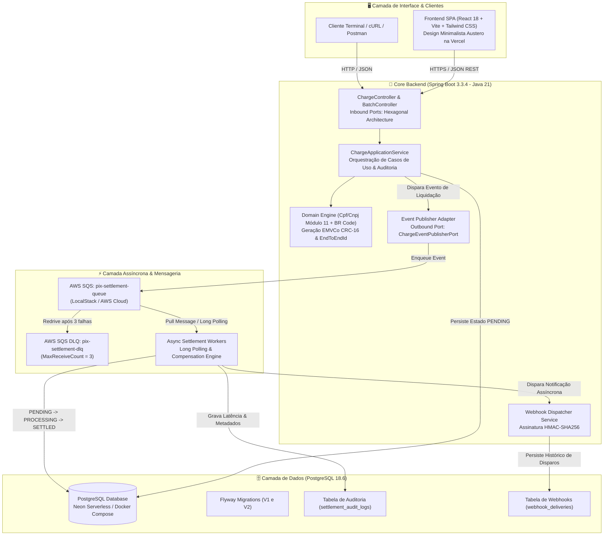
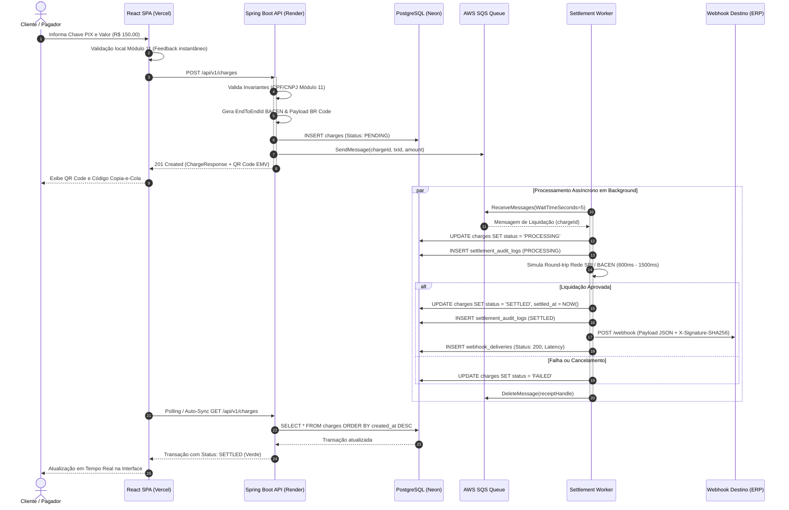
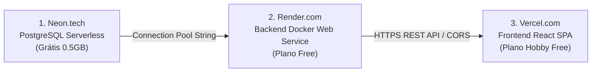

<div align="center">

# ⚡ PixFlow: Event-Driven Payment & Settlement Engine

**Motor Transacional de Alta Concorrência para Emissão, Liquidação Assíncrona e Notificação de Pagamentos Instantâneos (PIX)**

[](https://openjdk.org/projects/jdk/21/)
[](https://spring.io/projects/spring-boot)
[](https://www.postgresql.org/)
[](https://aws.amazon.com/sqs/)
[](https://www.docker.com/)
[](https://www.terraform.io/)
[](https://github.com/features/actions)
[](https://www.jacoco.org/)
[](https://frontend-hazel-six-05z2k7m6sk.vercel.app)
[](https://opensource.org/licenses/MIT)

<br/>

[🚀 Live Demo Web na Vercel](https://frontend-hazel-six-05z2k7m6sk.vercel.app) • [📖 Swagger / OpenAPI Docs](https://pix-flow-backend.onrender.com/swagger-ui.html) • [🏗️ Arquitetura Técnica](#-arquitetura-do-sistema) • [🧪 Roteiro de Testes](#-roteiro-de-testes--homologação) • [☁️ Deploy 100% Gratuito](#-guia-de-deploy-100-gratuito)

</div>

---

## 📌 Visão Geral do Projeto

O **PixFlow** é uma solução de engenharia corporativa concebida para simular a infraestrutura de mensageria, liquidação em lote e processamento em tempo real de arranjos de pagamento instantâneos (padrão BACEN / SPI).

Projetado sob os princípios de **Clean Architecture (Arquitetura Hexagonal)** e **Domain-Driven Design (DDD)**, o motor desacopla a recepção síncrona de requisições de pagamento da efetiva compensação bancária através de filas assíncronas no **Amazon SQS** (ou emuladas localmente via **LocalStack**), garantindo tempos de resposta de borda na casa de dezenas de milissegundos e tolerância total a falhas com Dead-Letter Queues (DLQ).

### 🎯 Principais Diferenciais de Engenharia
- **Clean Architecture & Hexagonal Ports**: Separação rigorosa entre `domain`, `application` (use cases) e `infrastructure` (adapters web, mensageria e persistência).
- **Validação Canônica Módulo 11**: Algoritmos matemáticos estritos para validação de CPF e CNPJ (com rejeição de sequências e dígitos verificadores incorretos), RFC 5322 para e-mail e E.164 para telefone.
- **Validação de Invariantes & Padrão BACEN**: Emissão de identificador `EndToEndId` padrão Banco Central (32 caracteres alfanuméricos com ISPB e timestamp) e geração em código do payload TLV EMVCo BR Code (Tag 00 a 63 com cálculo de checksum CRC-16/CCITT-FALSE).
- **Processamento em Lote Concorrente (Stress Lab)**: Endpoint `/api/v1/charges/batch` capaz de executar dezenas de liquidações simultâneas em threads paralelas e calcular métricas de Throughput (TPS).
- **Webhooks com Assinatura Criptográfica HMAC-SHA256**: Despacho de eventos `PIX.SETTLED` e `PIX.FAILED` com cabeçalho `X-Signature-SHA256` para garantia de autenticidade e integridade no destino.
- **Linha do Tempo e Auditoria Imutável**: Endpoint `/api/v1/charges/{id}/timeline` detalhando cada etapa do worker (`CREATED` ➔ `SQS_ENQUEUED` ➔ `SETTLEMENT_STARTED` ➔ `SETTLED`) e exportação completa do livro-razão em CSV.
- **DevOps & Portabilidade Híbrida**: Provisionamento declarativo via **Terraform** compatível tanto com **AWS Free Tier** quanto com **LocalStack**, viabilizando hospedagem em nuvem **100% gratuita no Render, Neon e Vercel**.
- **Engenharia de Qualidade**: 90 testes automatizados (unitários de domínio, serviços e integração WebMvc com MockMvc) atingindo **87% de cobertura de código verificada via JaCoCo** na esteira de CI/CD.

---

## 🏛️ Arquitetura do Sistema

### 1. Topologia de Componentes e Fluxo de Mensageria



### 2. Diagrama de Sequência: Ciclo de Liquidação e Webhook HMAC



---

## 🗂️ Estrutura de Diretórios do Projeto

```text
pix-flow/
├── .github/
│   └── workflows/
│       └── ci-cd.yml                # Esteira automatizada (Testes, JaCoCo, Node, Terraform, Docker)
├── backend/
│   ├── src/
│   │   ├── main/
│   │   │   ├── java/com/matheus/pixflow/
│   │   │   │   ├── PixFlowApplication.java
│   │   │   │   ├── domain/          # Entidades puras, Enums, Cpf/Cnpj Validators (Módulo 11)
│   │   │   │   ├── application/     # Casos de uso, DTOs, Batch Services e Webhooks
│   │   │   │   └── infrastructure/  # Adaptadores REST, Persistência JPA, SQS e Webhooks
│   │   │   └── resources/
│   │   │       ├── application.yml
│   │   │       └── db/migration/
│   │   │           ├── V1__init_schema.sql        # Esquema de charges e settlement_audit_logs
│   │   │           └── V2__webhook_deliveries.sql # Esquema de auditoria de webhooks
│   │   └── test/java/com/matheus/pixflow/         # 90 Testes Unitários e MockMvc (87% Cobertura)
│   ├── Dockerfile                   # Multi-Stage Build (JDK 21 compile -> JRE 21 Alpine runner)
│   ├── pom.xml                      # Dependências Maven e Plugin JaCoCo (80% gate)
│   └── mvnw                         # Maven Wrapper oficial
├── frontend/
│   ├── src/
│   │   ├── views/
│   │   │   ├── TerminalView.jsx     # Emissão PIX com validação Módulo 11 e sample keys
│   │   │   ├── LedgerView.jsx       # Livro-Razão de alta densidade e exportação CSV
│   │   │   ├── StressLabView.jsx    # Gerador de concorrência e carga em lote
│   │   │   ├── WebhooksView.jsx     # Rastreamento de entregas de webhooks e HMAC
│   │   │   └── TutorialView.jsx     # Roteiro interativo de testes com 6 botões 1-clique
│   │   ├── components/
│   │   │   ├── Navbar.jsx           # Navegação institucional fintech e telemetria
│   │   │   ├── StatusBadge.jsx      # Badges minimalistas de status
│   │   │   ├── TransactionDrawer.jsx# Gaveta lateral com Timeline do worker e JSON
│   │   │   ├── LatencyMonitor.jsx   # Indicadores de volume, sucesso e tempo de liquidação
│   │   │   ├── QrCodeModal.jsx      # Modal EMVCo BR Code
│   │   │   └── ArchitectureModal.jsx# Diagrama arquitetural
│   │   ├── utils/
│   │   │   └── validators.js        # Validadores canônicos Módulo 11 no frontend
│   │   ├── services/api.js          # Cliente HTTP unificado
│   │   ├── App.jsx                  # Coordenador de estado SPA
│   │   └── main.jsx
│   ├── package.json                 # React 18, Vite 5, Tailwind CSS, Lucide Icons, QRCode.react
│   ├── tailwind.config.js
│   └── vite.config.js
├── terraform/
│   ├── main.tf                      # VPC, Subnets, SG, EC2 t3.micro, SQS + DLQ, S3 e IAM
│   ├── variables.tf                 # Parametrização para AWS Cloud e LocalStack
│   ├── outputs.tf                   # URLs, ARNs e IPs de saída
│   └── terraform.tfvars.example
├── docker-compose.yml               # Orquestração local em 1 comando (App, Postgres, LocalStack)
└── README.md                        # Documentação Técnica Internacional
```

---

## 🔌 Tabela de Endpoints REST

A documentação interativa com Swagger UI está acessível em `/swagger-ui.html`.

| Método | Endpoint | Descrição | Status Sucesso | Status Erro |
| :--- | :--- | :--- | :---: | :---: |
| `POST` | `/api/v1/charges` | Emite uma nova cobrança PIX com QR Code EMVCo | `201 Created` | `400`, `422` |
| `POST` | `/api/v1/charges/batch` | Emite lote de cobranças concorrentes em paralelo | `200 OK` | `400` |
| `GET` | `/api/v1/charges` | Lista transações com paginação (`page`, `size`) | `200 OK` | `400` |
| `GET` | `/api/v1/charges/{id}` | Consulta detalhes de uma cobrança por UUID | `200 OK` | `404` |
| `GET` | `/api/v1/charges/{id}/timeline` | Consulta timeline completa de auditoria do worker | `200 OK` | `404` |
| `GET` | `/api/v1/charges/export` | Exporta todo o histórico do livro-razão em formato CSV | `200 OK` | `500` |
| `POST` | `/api/v1/charges/{id}/cancel` | Cancela uma cobrança em estado `PENDING` | `200 OK` | `404`, `409` |
| `POST` | `/api/v1/charges/{id}/settle` | Simula compensação bancária forçada imediata | `200 OK` | `404`, `409` |
| `GET` | `/api/v1/webhooks` | Lista histórico de webhooks disparados pelo motor | `200 OK` | `500` |
| `GET` | `/api/v1/webhooks/{id}` | Consulta detalhes e assinatura HMAC de um webhook | `200 OK` | `404` |
| `POST` | `/api/v1/webhooks/{id}/replay` | Simula reenvio (replay) de uma notificação | `200 OK` | `404` |
| `GET` | `/api/v1/metrics` | Retorna métricas de volume, latência e fila | `200 OK` | `500` |
| `GET` | `/actuator/health` | Healthcheck do Spring Boot Actuator | `200 OK` | `503` |

---

## 🧪 Roteiro de Testes & Homologação

A interface web inclui uma aba exclusiva **"Roteiro & Testes"** com botões de 1 clique para executar cada cenário interativamente:

### Cenário 1: Happy Path de Liquidação
- **Objetivo**: Validar emissão com chave CPF válida (`529.982.247-25`), enfileiramento e compensação após 1200ms.
```bash
curl -s -X POST https://pix-flow-backend.onrender.com/api/v1/charges \
  -H "Content-Type: application/json" \
  -d '{"pixKey":"52998224725","pixKeyType":"CPF","amount":150.00,"description":"Cenário 1"}' | jq .
```

### Cenário 2: Validação Canônica Módulo 11 (Rejeição de CPF Inválido)
- **Objetivo**: Confirmar que o motor rejeita chaves matematicamente inválidas com HTTP 422 Unprocessable Entity.
```bash
curl -s -i -X POST https://pix-flow-backend.onrender.com/api/v1/charges \
  -H "Content-Type: application/json" \
  -d '{"pixKey":"12345678911","pixKeyType":"CPF","amount":50.00}'
# Retorna: HTTP/2 422 Unprocessable Entity - CPF inválido (dígitos verificadores incorretos)
```

### Cenário 3: Cancelamento de Cobrança Pré-Liquidação
- **Objetivo**: Estornar cobrança em estado PENDING antes da liquidação financeira definitiva.
```bash
# 1. Cria cobrança
ID=$(curl -s -X POST https://pix-flow-backend.onrender.com/api/v1/charges \
  -H "Content-Type: application/json" \
  -d '{"pixKey":"admin@pixflow.io","pixKeyType":"EMAIL","amount":25.00}' | jq -r .id)

# 2. Cancela imediatamente
curl -s -X POST https://pix-flow-backend.onrender.com/api/v1/charges/$ID/cancel | jq '{id, status}'
```

### Cenário 4: Teste de Carga e Concorrência (Batch)
- **Objetivo**: Disparar lote concorrente de 10 transações paralelas e obter o Throughput (TPS).
```bash
curl -s -X POST https://pix-flow-backend.onrender.com/api/v1/charges/batch \
  -H "Content-Type: application/json" \
  -d '{
    "charges": [
      {"pixKey": "52998224725", "pixKeyType": "CPF", "amount": 10.00},
      {"pixKey": "04252011000110", "pixKeyType": "CNPJ", "amount": 20.00},
      {"pixKey": "tech@pixflow.io", "pixKeyType": "EMAIL", "amount": 30.00}
    ]
  }' | jq .
```

### Cenário 5: Auditoria de Webhook e Assinatura HMAC-SHA256
- **Objetivo**: Verificar histórico de notificações assíncronas e assinatura do cabeçalho `X-Signature-SHA256`.
```bash
curl -s https://pix-flow-backend.onrender.com/api/v1/webhooks | jq .
```

---

## ☁️ Guia de Deploy 100% Gratuito



### Passo 1: Banco de Dados PostgreSQL no Neon (neon.tech)
1. Acesse [neon.tech](https://neon.tech) e crie uma conta gratuita.
2. Crie um projeto chamado `pixflow-db` na região `sa-east-1` ou `us-east-1`.
3. Obtenha a connection string JDBC com SSL habilitado:
   ```text
   jdbc:postgresql://<host-neon>/neondb?sslmode=require
   ```
*(O Flyway aplicará automaticamente as migrations `V1__init_schema.sql` e `V2__webhook_deliveries.sql` na inicialização).*

---

### Passo 2: Core Backend no Render (render.com)
1. Acesse [render.com](https://render.com) e conecte o repositório `matheus-araujo-pereira/pix-flow`.
2. Configure o serviço:
   - **Root Directory**: `backend`
   - **Runtime**: `Docker`
   - **Instance Type**: `Free`
3. Configure as variáveis de ambiente:
   | Chave | Valor |
   | :--- | :--- |
   | `SPRING_PROFILES_ACTIVE` | `prod` |
   | `DB_URL` | URL JDBC do Neon (`?sslmode=require`) |
   | `DB_USER` | Usuário do Neon |
   | `DB_PASSWORD` | Senha do Neon |
   | `PIXFLOW_MESSAGING_PROVIDER` | `in-memory` |
   | `PORT` | `8080` |
   | `CORS_ALLOWED_ORIGINS` | `https://*.vercel.app,http://localhost:5173` |

---

### Passo 3: Frontend SPA na Vercel (vercel.com)
1. Acesse [vercel.com](https://vercel.com) e importe o repositório.
2. Defina o **Root Directory** como `frontend`.
3. Adicione a variável de ambiente:
   - `VITE_API_URL`: `https://pix-flow-backend.onrender.com`
4. Clique em **Deploy**. O painel com design minimalista estará online imediatamente!

---

### Passo 4: Execução Local no Fedora 44 (KDE Plasma)

```bash
# 1. Instalar dependências no Fedora 44
sudo dnf install -y git podman podman-compose java-21-openjdk-devel nodejs

# 2. Subir infraestrutura local via Podman
podman-compose up -d --build

# 3. Rodar Frontend em modo hot-reload
cd frontend
npm install
npm run dev
# Acesse: http://localhost:5173
```

---

## 🧪 Engenharia de Qualidade & Testes

Para executar toda a suíte de testes unitários e de integração validando o portão de 80% do JaCoCo:

```bash
cd backend
./mvnw clean verify
```

O relatório HTML detalhado de cobertura por pacote e branch é gerado em:
```text
backend/target/site/jacoco/index.html
```

---

## 👨‍💻 Autor

**Matheus Araujo Pereira**  
- GitHub: [@matheus-araujo-pereira](https://github.com/matheus-araujo-pereira)  
- LinkedIn: [Matheus Araujo Pereira](https://linkedin.com)  
- Email: matharaupere@gmail.com  

---

<div align="center">
  <sub>Desenvolvido com foco em excelência arquitetural, portabilidade e resiliência transacional sob Java 21, AWS e Linux.</sub>
</div>
