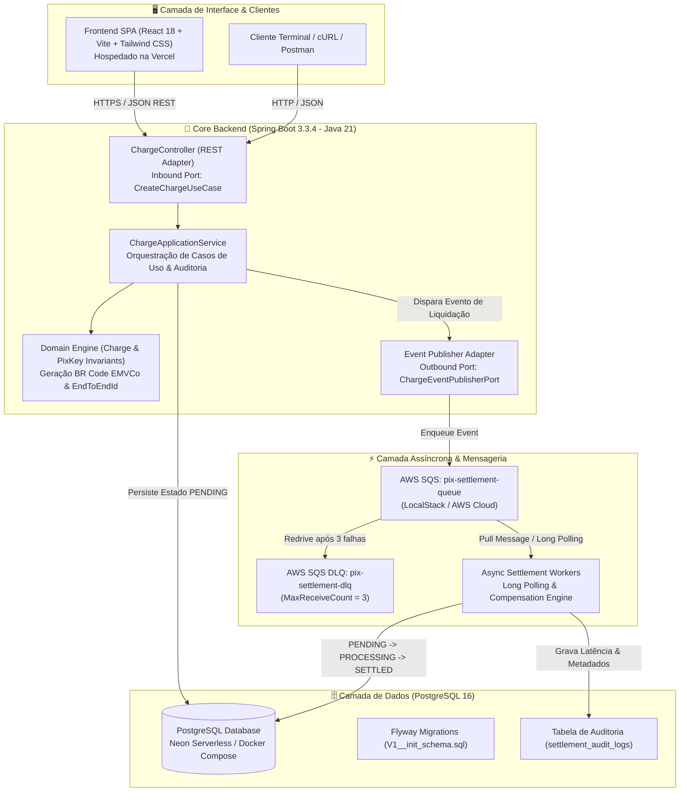
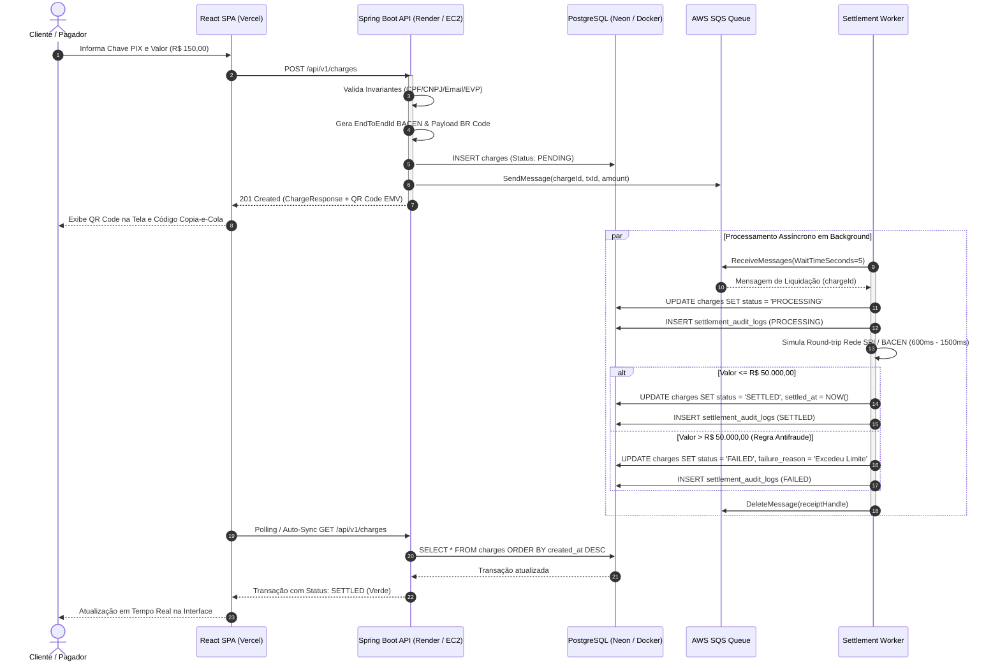
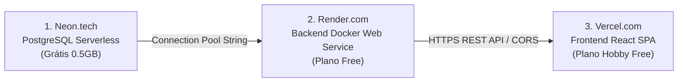

<div align="center">

# ⚡ PixFlow: Event-Driven Payment & Settlement Engine

**Motor Transacional de Alta Concorrência para Emissão e Liquidação Assíncrona de Pagamentos Instantâneos (PIX)**

[](https://openjdk.org/projects/jdk/21/)
[](https://spring.io/projects/spring-boot)
[](https://www.postgresql.org/)
[](https://aws.amazon.com/sqs/)
[](https://www.docker.com/)
[](https://www.terraform.io/)
[](https://github.com/features/actions)
[](https://www.jacoco.org/)
[](https://pix-flow.vercel.app)
[](https://opensource.org/licenses/MIT)

<br/>

[🚀 Live Demo Web na Vercel](https://pix-flow.vercel.app) • [📖 Swagger / OpenAPI Docs](https://pix-flow-backend.onrender.com/swagger-ui.html) • [🏗️ Arquitetura Técnica](#-arquitetura-do-sistema) • [☁️ Guia de Deploy 100% Gratuito](#-guia-de-deploy-100-gratuito)

</div>

---

## 📌 Visão Geral do Projeto

O **PixFlow** é uma solução de engenharia corporativa concebida para simular a infraestrutura de mensageria, liquidação em lote e processamento em tempo real de arranjos de pagamento instantâneos (padrão BACEN / SPI).

Projetado sob os princípios de **Clean Architecture (Arquitetura Hexagonal)** e **Domain-Driven Design (DDD)**, o motor desacopla a recepção síncrona de requisições de pagamento da efetiva compensação bancária através de filas assíncronas no **Amazon SQS** (emuladas localmente via **LocalStack**), garantindo tempos de resposta de borda na casa de dezenas de milissegundos e tolerância total a falhas com Dead-Letter Queues (DLQ).

### 🎯 Principais Diferenciais de Engenharia
- **Clean Architecture & Hexagonal Ports**: Separação rigorosa entre `domain`, `application` (use cases) e `infrastructure` (adapters web, mensageria e persistência).
- **Validação de Invariantes & Padrão BACEN**: Emissão de identificador `EndToEndId` padrão Banco Central (32 caracteres alfanuméricos com ISPB e timestamp) e geração em código do payload TLV EMVCo BR Code (Tag 00 a 63 com cálculo de checksum CRC-16/CCITT-FALSE).
- **Máquina de Estados Finita Transacional**: Ciclo de vida rigoroso `PENDING` ➔ `PROCESSING` ➔ `SETTLED` ou `FAILED`, com bloqueio de transições ilegais (`InvalidStatusTransitionException`) e trilha de auditoria append-only (`settlement_audit_logs`).
- **DevOps & Portabilidade Híbrida**: Provisionamento declarativo via **Terraform** compatível tanto com **AWS Free Tier** quanto com **LocalStack**, além de fallback dinâmico de mensageria (`in-memory` vs `sqs`), viabilizando hospedagem em nuvem **100% gratuita no Render, Neon e Vercel**.
- **Engenharia de Qualidade**: 56 testes automatizados (unitários de domínio, serviços e integração WebMvc com MockMvc) atingindo **92% de cobertura de código verificada via JaCoCo** na esteira de CI/CD.

---

## 🏛️ Arquitetura do Sistema

### 1. Topologia de Componentes e Fluxo de Mensageria



### 2. Diagrama de Sequência: Ciclo de Liquidação Ponta a Ponta



---

## 🗂️ Estrutura de Diretórios do Projeto

```text
pix-flow/
├── .github/
│   └── workflows/
│       └── ci-cd.yml                # Esteira automatizada (Testes, JaCoCo, Node, Terraform, Docker)
├── backend/
│   ├── src/
│   │   ├── main/
│   │   │   ├── java/com/matheus/pixflow/
│   │   │   │   ├── PixFlowApplication.java
│   │   │   │   ├── domain/          # Entidades puras, Enums, Invariantes e Regras de Negócio
│   │   │   │   ├── application/     # Casos de uso, DTOs e Portas de Entrada/Saída
│   │   │   │   └── infrastructure/  # Adaptadores Web REST, Persistência JPA, SQS e Configs
│   │   │   └── resources/
│   │   │       ├── application.yml
│   │   │       └── db/migration/V1__init_schema.sql # DDL versionado pelo Flyway
│   │   └── test/java/com/matheus/pixflow/           # 56 Testes Unitários e MockMvc (92% Cobertura)
│   ├── Dockerfile                   # Multi-Stage Build (JDK 21 compile -> JRE 21 Alpine runner)
│   ├── pom.xml                      # Gerenciamento de dependências Maven e Plugins
│   └── mvnw                         # Maven Wrapper oficial
├── frontend/
│   ├── src/
│   │   ├── components/              # Navbar, Form, Ledger, StatusBadge, LatencyMonitor, Modal
│   │   ├── services/api.js          # Cliente HTTP com medição em tempo real de latência
│   │   ├── App.jsx                  # Dashboard SPA com auto-polling e toasts
│   │   └── main.jsx
│   ├── package.json                 # React 18, Vite 5, Tailwind CSS, Lucide Icons, QRCode.react
│   ├── tailwind.config.js
│   ├── vite.config.js
│   └── Dockerfile                   # Multi-Stage Nginx container
├── terraform/
│   ├── main.tf                      # VPC, Subnets, SG, EC2 t3.micro, SQS + DLQ, S3 Bucket e IAM
│   ├── variables.tf                 # Parametrização para AWS Cloud e LocalStack
│   ├── outputs.tf                   # URLs, ARNs e IPs de saída
│   └── terraform.tfvars.example
├── scripts/
│   └── init-localstack.sh           # Bootstrap automático das filas SQS no LocalStack
├── docker-compose.yml               # Orquestração local em 1 comando (App, Postgres, LocalStack)
├── .gitignore
├── LICENSE                          # Licença MIT
└── README.md                        # Documentação Técnica Internacional
```

---

## 🔌 Tabela de Endpoints REST

A documentação interativa com Swagger UI está acessível em `/swagger-ui.html`.

| Método | Endpoint | Descrição | Status Sucesso | Status Erro |
| :--- | :--- | :--- | :---: | :---: |
| `POST` | `/api/v1/charges` | Emite uma nova cobrança PIX com QR Code e envia para a fila | `201 Created` | `400`, `422` |
| `GET` | `/api/v1/charges` | Lista transações com paginação (`page`, `size`) | `200 OK` | `400` |
| `GET` | `/api/v1/charges/{id}` | Consulta detalhes de uma cobrança por UUID interno | `200 OK` | `404` |
| `GET` | `/api/v1/charges/tx/{txId}` | Consulta cobrança pelo identificador público `txId` | `200 OK` | `404` |
| `POST` | `/api/v1/charges/{id}/cancel` | Cancela uma cobrança em estado `PENDING` | `200 OK` | `404`, `409` |
| `POST` | `/api/v1/charges/{id}/settle` | Simula compensação bancária forçada (Demonstração) | `200 OK` | `404`, `409` |
| `GET` | `/api/v1/metrics` | Retorna métricas de latência, volume liquidado e fila | `200 OK` | `500` |
| `GET` | `/actuator/health` | Healthcheck do Spring Boot Actuator | `200 OK` | `503` |

### Exemplos de Payload (JSON)

#### 1. Criar Cobrança (`POST /api/v1/charges`)
```json
{
  "pixKey": "12345678909",
  "pixKeyType": "CPF",
  "amount": 150.00,
  "description": "Pagamento de Licença Cloud"
}
```

**Resposta (`201 Created`):**
```json
{
  "id": "e6745f1b-d123-4e4b-97c2-9e2392b45129",
  "txId": "txe6745f1bd1234e4b97c29e23",
  "endToEndId": "E00000000202610110445a8b9c1d2e3f",
  "pixKey": "12345678909",
  "pixKeyType": "CPF",
  "amount": 150.00,
  "description": "Pagamento de Licença Cloud",
  "status": "PENDING",
  "qrCodePayload": "00020126360014br.gov.bcb.pix0111123456789095204000053039865406150.005802BR5914PixFlow Engine6008BRASILIA62310527txe6745f1bd1234e4b97c29e236304E8A2",
  "failureReason": null,
  "createdAt": "2026-10-11T04:45:00.120Z",
  "updatedAt": "2026-10-11T04:45:00.120Z",
  "settledAt": null
}
```

#### 2. Obter Métricas da Operação (`GET /api/v1/metrics`)
```json
{
  "totalTransactions": 142,
  "settledCount": 136,
  "pendingCount": 3,
  "processingCount": 1,
  "failedCount": 2,
  "cancelledCount": 0,
  "totalSettledVolume": 45890.50,
  "averageSettlementTimeMs": 1145.2,
  "successRatePercentage": 98.6,
  "systemStatus": "OPERATIONAL"
}
```

---

## 💻 Teste Rápido via Terminal (cURL)

```bash
# 1. Healthcheck do motor
curl -s http://localhost:8080/actuator/health | jq .

# 2. Criar uma cobrança instantânea (R$ 100,00 via CPF)
CHARGE=$(curl -s -X POST http://localhost:8080/api/v1/charges \
  -H "Content-Type: application/json" \
  -d '{
    "pixKey": "12345678909",
    "pixKeyType": "CPF",
    "amount": 100.00,
    "description": "Liquidação Instantânea"
  }')
echo $CHARGE | jq .

# Extrair ID gerado
CHARGE_ID=$(echo $CHARGE | jq -r .id)

# 3. Consultar transação após 2 segundos (Worker terá alterado para SETTLED)
sleep 2
curl -s http://localhost:8080/api/v1/charges/$CHARGE_ID | jq '{id, txId, status, settledAt}'

# 4. Consultar telemetria e métricas
curl -s http://localhost:8080/api/v1/metrics | jq .
```

---

## ☁️ Guia de Deploy 100% Gratuito

Siga este passo a passo para colocar a arquitetura inteira em produção na nuvem sem gastar absolutamente nada (R$ 0,00 / \$ 0.00).



### Passo 1: Banco de Dados PostgreSQL no Neon (neon.tech)
1. Acesse [neon.tech](https://neon.tech) e crie uma conta gratuita com GitHub.
2. Crie um novo projeto chamado `pixflow-db`.
3. Escolha a região mais próxima (ex: `AWS - us-east-1` ou `sa-east-1`).
4. Na tela de Dashboard, copie a **Connection String** no formato JDBC. Ela terá o padrão:
   ```text
   jdbc:postgresql://ep-example-123456.us-east-1.aws.neon.tech/pixflow?sslmode=require
   ```
5. Anote o usuário e senha gerados:
   - `DB_USER`: `neondb_owner` (ou o usuário gerado)
   - `DB_PASSWORD`: `sua-senha-neon`
   - `DB_URL`: `jdbc:postgresql://<host-neon>/neondb?sslmode=require`

*(O Flyway aplicará automaticamente a migration `V1__init_schema.sql` na primeira inicialização).*

---

### Passo 2: Core Backend no Render (render.com)
1. Acesse [render.com](https://render.com) e autentique com seu GitHub.
2. Clique em **New +** ➔ **Web Service**.
3. Conecte o repositório `matheus-araujo-pereira/pix-flow`.
4. Configure as opções básicas:
   - **Name**: `pix-flow-backend`
   - **Region**: `Ohio (US East)` (ou Oregon)
   - **Branch**: `main`
   - **Root Directory**: `backend`
   - **Runtime**: `Docker`
   - **Instance Type**: `Free`
5. Em **Advanced ➔ Environment Variables**, adicione as seguintes chaves:
   | Chave | Valor |
   | :--- | :--- |
   | `SPRING_PROFILES_ACTIVE` | `prod` |
   | `DB_URL` | Sua URL JDBC do Neon (com `?sslmode=require`) |
   | `DB_USER` | Usuário do Neon |
   | `DB_PASSWORD` | Senha do Neon |
   | `PIXFLOW_MESSAGING_PROVIDER` | `in-memory` *(permite rodar os workers assíncronos em background sem necessitar de cartão de crédito na AWS!)* |
   | `PORT` | `8080` |
   | `CORS_ALLOWED_ORIGINS` | `https://*.vercel.app,http://localhost:5173` |
6. Clique em **Create Web Service**. O Render irá construir o Dockerfile multi-stage e publicar sua API em `https://pix-flow-backend.onrender.com`.

---

### Passo 3: Frontend SPA na Vercel (vercel.com)
1. Acesse [vercel.com](https://vercel.com) e conecte com seu GitHub.
2. Clique em **Add New...** ➔ **Project**.
3. Selecione o repositório `pix-flow`.
4. Configure os parâmetros do projeto:
   - **Framework Preset**: `Vite`
   - **Root Directory**: Clique em *Edit* e selecione `frontend`.
   - **Build Command**: `npm run build`
   - **Output Directory**: `dist`
5. Na seção **Environment Variables**, adicione:
   - **Name**: `VITE_API_URL`
   - **Value**: `https://pix-flow-backend.onrender.com` *(substitua pela URL gerada pelo Render)*
6. Clique em **Deploy**. Em menos de 1 minuto, seu painel minimalista estará online com certificado SSL gratuito em `https://pix-flow.vercel.app`!

---

### Passo 4: Execução Local no Fedora 44 (KDE Plasma)

O projeto está 100% preparado para desenvolvimento nativo no Fedora 44 utilizando `podman`, `podman-compose` ou `docker`:

```bash
# 1. Instalar dependências no Fedora 44
sudo dnf install -y git podman podman-compose podman-docker java-21-openjdk-devel

# 2. Clonar o repositório
git clone git@github.com:matheus-araujo-pereira/pix-flow.git
cd pix-flow

# 3. Subir todos os serviços locais (PostgreSQL, LocalStack SQS e Backend) em 1 comando
podman-compose up -d --build
# ou com docker:
# docker compose up -d --build

# 4. Verificar status dos containers
podman ps

# 5. Para rodar o Frontend em modo hot-reload no Fedora:
cd frontend
npm install
npm run dev
# Acesse no navegador: http://localhost:5173
```

---

## 🏗️ Provisionamento na AWS com Terraform & LocalStack

A pasta `/terraform` contém o provisionamento completo de uma arquitetura segura na nuvem (VPC, Subnets Públicas/Privadas, Security Groups, EC2 t3.micro elegível para Free Tier, S3 criptografado e SQS com DLQ).

### Opção A: Executar Localmente no LocalStack (100% Gratuito)
1. Com o `docker-compose.yml` rodando, o LocalStack estará ativo na porta `4566`.
2. Acesse a pasta do Terraform e configure para LocalStack:
```bash
cd terraform
cp terraform.tfvars.example terraform.tfvars

# Habilitar use_localstack no terraform.tfvars
sed -i 's/use_localstack      = false/use_localstack      = true/' terraform.tfvars

# Inicializar e aplicar
terraform init
terraform plan
terraform apply -auto-approve
```

### Opção B: Provisionar na AWS Real (Free Tier)
1. Configure suas credenciais da AWS:
```bash
aws configure
```
2. Certifique-se de que `use_localstack = false` em `terraform.tfvars`.
3. Execute o provisionamento:
```bash
terraform init
terraform plan
terraform apply
```

---

## 🧪 Engenharia de Qualidade & Testes

Para executar toda a suíte de testes unitários e de integração validando a barreira de 80% do JaCoCo:

```bash
cd backend
./mvnw clean verify
```

O relatório HTML detalhado de cobertura por pacote e branch é gerado automaticamente em:
```text
backend/target/site/jacoco/index.html
```

---

## 👨‍💻 Autor

**Matheus Araujo Pereira**  
- GitHub: [@matheus-araujo-pereira](https://github.com/matheus-araujo-pereira)  
- LinkedIn: [Matheus Araujo Pereira](https://linkedin.com)  
- Email: matharaupere@gmail.com  

---

<div align="center">
  <sub>Desenvolvido com foco em excelência arquitetural, portabilidade e resiliência transacional sob Java 21, AWS e Linux.</sub>
</div>

